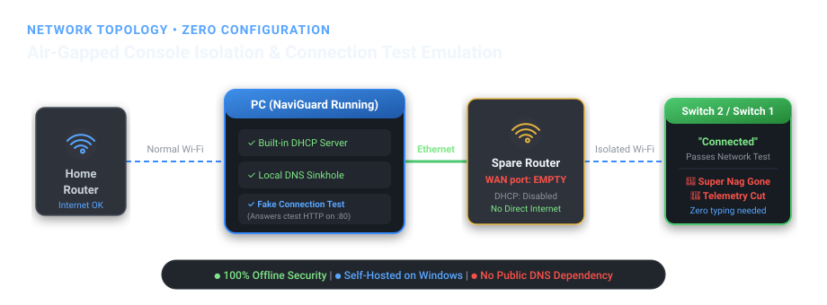

<div align="center">
  
  <h1>NaviGuard</h1>
  <p><strong>A self-hosted, local 90DNS alternative to avoid Nintendo update nags and safely isolate your Switch & Switch 2.</strong></p>

  <p>
    <a href="https://github.com/bibidibabidiboou/NaviGuard/releases"></a>
    <a href="LICENSE"></a>
    <a href="https://github.com/bibidibabidiboou/NaviGuard/releases"></a>
    <a href="https://www.python.org"></a>
  </p>

  <p>
    <a href="#key-features">Key Features</a> •
    <a href="#how-it-works">How It Works</a> •
    <a href="#why-naviguard-over-90dns">Why NaviGuard vs 90DNS</a> •
    <a href="#setup-guide">Setup Guide</a> •
    <a href="#troubleshooting">Troubleshooting</a> •
    <a href="#download">Download</a>
  </p>
</div>

---

> ⚠️ **Disclaimer:**
> - **Nintendo Affiliation:** NaviGuard is an independent open-source project and is not affiliated with, endorsed by, or associated with Nintendo. While NaviGuard effectively blocks console telemetry, update pings, and communication with Nintendo servers, no software can guarantee 100% protection against console bans. Always use responsibly with games and hardware you legally own.
> - **Vibe Coded Disclaimer:** This project was vibe coded with AI assistance (Google Gemini). While it is functional, tested, and gets the job done, feel free to inspect the code and use it at your own discretion! Pull requests and optimizations are always welcome.

---

## Overview

**NaviGuard** eliminates the persistent "Super Nag" (system and game update prompts) and blocks all telemetry communication between modded consoles (Nintendo Switch 1 & Switch 2) and Nintendo's servers—without relying on unreliable third-party public DNS servers like 90DNS.

By running locally on your Windows PC and pairing with any spare Wi-Fi router, NaviGuard creates a private, isolated sandbox network:

- **Automatic Configuration:** The console joins your spare router's Wi-Fi with default *automatic* settings. No manual IP or DNS entry needed on the console.
- **Connection Test Emulation:** Answers Nintendo's network tests (Switch 2: `ctest.p01.ctest.srv.nintendo.net`, Switch 1: `ctest.cdn.nintendo.net`, plus `conntest.nintendowifi.net` and any other Nintendo `ctest`/`conntest` host) locally, so the console happily reports **"Connected to the Internet"** without ever reaching external servers.
- **Air-Gapped & Leak-Proof:** The spare router's WAN port stays unplugged. Consoles cannot leak data or bypass DNS via hardcoded IPs.
- **Zero Terminal / Zero Dependencies:** Single portable `.exe` with a clean dark-mode GUI and system tray support.

---

## Network Architecture



```
 Internet ── Home router ~~ Wi-Fi ~~ PC ══ Ethernet cable ══ Spare router ~~ Wi-Fi ~~ Switch
                                     │                     (INTERNET port EMPTY,
                              NaviGuard                    DHCP turned OFF)
                     - hands console settings via DHCP
                     - answers DNS: sinkholes Nintendo servers
                     - local connection test spoofing → "Connected"
```

1. **The spare router has no external internet:** Its WAN/Internet port is left empty. Nothing on its Wi-Fi network can reach the outside world.
2. **NaviGuard provides DHCP:** It assigns the console its IP address, gateway, and points DNS directly at your PC.
3. **NaviGuard emulates Nintendo Connection Tests:** When the Switch tests its connection, NaviGuard's local HTTP server responds with the exact headers Nintendo expects (`X-Organization: Nintendo`), tricking the console into showing a successful connection.
4. **All Nintendo domains are blocked:** Telemetry, update checks, crash reporters, and CDN downloads are sinkholed to `127.0.0.1`.
5. **PC internet is unaffected:** Your PC continues using your home Wi-Fi for normal internet access uninterrupted.

---

## Why NaviGuard over 90DNS?

| Feature | Traditional 90DNS | NaviGuard (Spare Router) | NaviGuard (Home Wi-Fi) |
|---|:---:|:---:|:---:|
| **Server Host** | Public / Third-Party Server | **Your Local PC** | **Your Local PC** |
| **Downtime & Latency** | Frequent outages & high latency | **Zero Outages / Local Speed** | **Zero Outages / Local Speed** |
| **Security Risk** | Susceptible to DNS poisoning / rogue servers | **100% Transparent & Local** | **100% Transparent & Local** |
| **Console Setup** | Manual IP & DNS configuration | **Automatic (Zero console typing)** | Manual DNS entry |
| **Bypasses Direct IP Leaks** | ❌ No (telemetry with hardcoded IPs escapes) | 🟢 **Yes (Router has zero WAN)** | ❌ No (DNS lookups only) |
| **Connection Test Spoofing** | ❌ No (relies on Nintendo servers) | 🟢 **Yes (Emulated locally)** | 🟢 **Yes (Emulated locally)** |
| **Stops Super Nag** | Inconsistent | 🟢 **Guaranteed (Offline Mode)** | 🟢 **Yes** |

---

## Operating Modes

| Mode | Behavior | Best Used For |
|---|---|---|
| 🟢 **Offline** *(Recommended)* | **Sinkholes every domain** while answering the connection test locally. The console shows "Connected" but cannot load anything. | Modding, homebrew, offline gameplay, preventing system update nags. |
| 🟠 **Block Nintendo Only** | Blocks all Nintendo domains and subdomains while forwarding other traffic to upstream DNS (`1.1.1.1`, `9.9.9.9`). | Home Wi-Fi setups where homebrew apps (e.g. FTP, local streaming) require general internet access. |

---

## Setup Guide

### Method A: Spare Router Setup (Recommended — 10 Minutes, One-Time)

#### Requirements
- A Windows PC (Windows 10 or 11) with an **Ethernet port** and active **Wi-Fi**.
- Any spare Wi-Fi router (old routers sitting in a closet work great).
- One standard Ethernet cable.

#### Step 1: Physical Connection
1. Power on your spare router.
2. Connect one end of the Ethernet cable into one of the router's **LAN ports** (usually black or yellow, labeled 1–4).
3. Connect the other end into your **PC's Ethernet port**.
4. ⚠️ **Leave the INTERNET / WAN port on the spare router completely EMPTY.**

#### Step 2: Disable Router DHCP
1. Open **NaviGuard.exe** and click **Open router settings** (or navigate to `192.168.0.1` / `192.168.1.1` in your browser).
2. Log into the router admin panel (default credentials are usually printed on the router sticker).
3. Locate **DHCP Server** settings (under *LAN*, *Network*, or *Local Network*) and set it to **Disabled / Off**, then save.

#### Step 3: Configure PC (One-Click)
1. In NaviGuard, verify that **"Cable to router is on"** highlights your Ethernet adapter.
2. Click **Set up this PC (admin)** and approve the Windows UAC prompt.
3. This configures a static IP on the Ethernet adapter without a default gateway, preserving your PC's Wi-Fi internet.

#### Step 4: Start NaviGuard
1. Select **Offline** mode and click **Start**.
2. If prompted by Windows Defender Firewall, check the boxes to allow communication.
3. The checklist will turn green (✔).

#### Step 5: Connect Console
1. On your Switch / Switch 2, join the spare router's Wi-Fi network.
2. **Leave all IP and DNS settings on Automatic.**
3. NaviGuard's log will show:
   - `Console got address 192.168.0.xxx`
   - `Console connection test PASSED`
4. The console will connect successfully with all telemetry and update nags blocked!

---

### Method B: Home Wi-Fi Setup (No Extra Hardware)

If you do not have a spare router, NaviGuard can act as a local DNS sinkhole on your primary Wi-Fi network:

1. Launch NaviGuard, choose **Home Wi-Fi (manual DNS)**, pick your mode, and click **Start**.
2. Note the IP address displayed in NaviGuard (your PC's Wi-Fi IP).
3. On your Switch:
   `System Settings → Internet → Internet Settings → [Your Wi-Fi] → Change Settings → DNS Settings → Manual`
4. Enter your PC's IP address into **both** the **Primary DNS** and **Secondary DNS** fields.
   > ⚠️ Do not use `8.8.8.8` or any public DNS as secondary, or the console may fall back to it and connect to Nintendo.

---

## Resilience & Self-Healing

NaviGuard was built from the ground up to prevent user mistakes and recover automatically from network changes:
- **Adapter Disconnects:** Cable unplugs or network restarts are detected automatically; NaviGuard pauses and seamlessly resumes when reconnected.
- **Rogue DHCP Detection:** NaviGuard probes the line before starting its own DHCP server. If the router's DHCP server is still running, NaviGuard notifies you and automatically activates the moment the router's DHCP is turned off.
- **IP Conflict Avoidance:** NaviGuard manages its own DHCP lease pool and maintains consistent IP leases for your console.
- **Zero System Overhead:** Runs in the Windows system tray with virtually 0% CPU usage.

---

## Advanced Configuration

- **`blocklist.txt`**: Place custom domains (one per line) next to `NaviGuard.exe` to block additional tracking or analytics servers.
- **`allowlist.txt`**: Place domains here that should bypass the filter when using *Block Nintendo only* mode.
- **Rule Scope:** In *Block Nintendo only* mode, any domain containing a label prefix of `nintendo` (e.g. `nintendo.net`, `nintendo.com`, `nintendowifi.net`, `nintendo-europe.com`, `nintendoswitch.cn`) and all subdomains are blocked automatically.

---

## Building from Source

NaviGuard is written in pure Python 3 without heavy external dependencies for its core engine.

### Prerequisites
- Python 3.8 or higher (Tkinter included in official Windows installer)

### Run from Source
```bat
git clone https://github.com/bibidibabidiboou/NaviGuard.git
cd NaviGuard
python src\gui.py
```

### Build Portable Executable
To package NaviGuard into a single, portable Windows `.exe`:
```bat
build.bat
```
The compiled executable will be output to `release\NaviGuard.exe`.

---

## Download

Get the latest release from the [Releases](https://github.com/bibidibabidiboou/NaviGuard/releases) tab:
- **`NaviGuard.exe`**: Standalone executable (no installation required).
- **`NaviGuard-v3.0.0.zip`**: Complete bundle including default configuration files and documentation.

---

## Contributors

- [@bibidibabidiboou](https://github.com/bibidibabidiboou) — Creator & Maintainer
- [@gemini-code-assist](https://github.com/gemini-code-assist) (Google Gemini) — Contributor & AI Co-Developer

---

## Contributors

- [@bibidibabidiboou](https://github.com/bibidibabidiboou) — Creator & Maintainer
- [@gemini-code-assist](https://github.com/gemini-code-assist) (Google Gemini) — Contributor & AI Co-Developer

---

## License

This project is licensed under the [MIT License](LICENSE).
Nintendo Switch and Nintendo Switch 2 are registered trademarks of Nintendo Co., Ltd.
